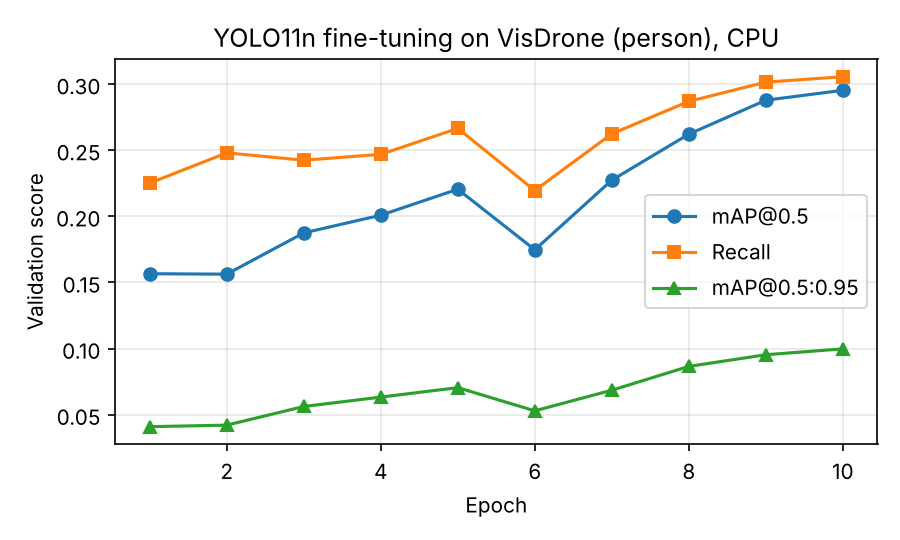

# AIoT-SAR — RGB person-detection baseline (Milestone 1, E1)

Milestone: **18 October 2026 — dataset selection, code repository, and RGB detection baseline.**
Verification: saved training/inference scripts (`scripts/`) and sample predictions (`results/`).
Completed 20 October 2026.

## 1. Dataset selection

**VisDrone2019-DET** (Zhu et al., AISKYEYE, Tianjin University). This is drone-captured RGB imagery from
14 cities at varying altitudes and viewing angles. It is used here as a public proxy for UAV search imagery.

| Split | Images | Person boxes |
|---|---|---|
| Train subset (random, seed 0; list in `results/train_list.txt`) | 1,000 of 6,471 | 16,161 |
| Val (official, full) | 548 | 13,969 |

- `pedestrian` (1) and `people` (2, non-standing persons) were merged into a single class, `person`. Boxes marked
  ignored (score 0) and all other categories were dropped.
- The official train/val split is kept, so validation scenes were never seen in training.
- **Licence / use:** VisDrone is released for academic research only. Cite the VisDrone benchmark paper if
  the results are published. Download mirror used: Ultralytics GitHub release assets.
- **Limitation:** VisDrone is urban, daytime and RGB only. It contains no disaster scenes, rubble, smoke or
  thermal imagery. SAR-specific data (e.g., HERIDAL, SARD) and thermal data belong to Milestone 2.

## 2. Repository layout

```
scripts/prepare_visdrone.py   VisDrone -> single-class YOLO format (seeded subset)
scripts/train.py              fine-tune YOLO11n (CPU defaults; GPU-ready flags)
scripts/evaluate.py           mAP, precision, recall, false-negative rate, CPU latency -> results/metrics_*.json
scripts/predict.py            inference on images -> annotated JPGs + predictions.json
scripts/make_report_figures.py results table, training curve, side-by-side comparisons
results/                      all evidence (metrics JSON, table, figures, sample predictions)
weights_ft_yolo11n_best.pt    fine-tuned weights (5.3 MB)
logs/train_ft_yolo11n.log     full training log
```

## 3. Reproduce

```bash
pip install -r requirements.txt
# download VisDrone2019-DET-train.zip and -val.zip into data/raw/ and unzip
python scripts/prepare_visdrone.py --raw data/raw --out data/visdrone_person --train-subset 1000 --seed 0
python scripts/evaluate.py --weights yolo11n.pt --name zeroshot_yolo11n
python scripts/train.py --epochs 10 --name ft_yolo11n
python scripts/evaluate.py --weights weights_ft_yolo11n_best.pt --name finetuned_yolo11n
python scripts/predict.py --weights yolo11n.pt --n 6 --out results/samples/zeroshot
python scripts/predict.py --weights weights_ft_yolo11n_best.pt --n 6 --out results/samples/finetuned
python scripts/make_report_figures.py
```
Training settings: YOLO11n (COCO-pretrained), imgsz 640, batch 8, 10 epochs, seed 0, `deterministic=True`, CPU.
Evaluation settings: conf 0.001, NMS IoU 0.6, max_det 1000, only class 0 scored. Both models use identical settings.

## 4. Results (VisDrone2019-DET-val, 548 images)

| Model | mAP@0.5 | mAP@0.5:0.95 | Precision | Recall | False-negative rate | CPU latency ms/img (mean / p95) |
|---|---|---|---|---|---|---|
| YOLO11n, COCO-pretrained (zero-shot) | 0.174 | 0.060 | 0.486 | 0.180 | 0.820 | 79.1 / 102.1 |
| YOLO11n, fine-tuned 10 epochs on 1,000 VisDrone images | **0.308** | **0.101** | 0.491 | **0.312** | **0.688** | 74.9 / 97.3 |

Hardware: cloud container, 2 vCPUs (x86_64), no GPU. Software: Python 3.13.16, torch 2.14.1, ultralytics 8.4.183.
Precision and recall are reported at the F1-maximising confidence threshold (the Ultralytics default). Latency is
end-to-end `predict()` time on 50 validation images after 5 warm-up images, with batch size 1.



## 5. Observations

1. **A COCO-pretrained detector misses most aerial people.** Zero-shot recall is 0.18, so about 82% of annotated
   people are missed. People seen from a drone are small and viewed from above, which COCO rarely contains.
2. **A short fine-tune helps substantially.** It gives +0.134 mAP@0.5 (0.174 → 0.308) and +0.13 recall after
   about 1.5 h on CPU. Validation mAP was still rising at epoch 10, so the model is under-trained. A full-data
   GPU run is expected to improve it further; this is not yet measured.
3. **There is a scale trade-off.** In the sample comparisons, the fine-tuned model finds many more small,
   distant people (e.g., 15 → 26 detections in `comparison_0000069_*.jpg`). However, it misses some large
   people close to the camera that the COCO model detected (`comparison_0000103_*.jpg`). The 1,000-image
   subset is dominated by small targets. Mitigations to test include the full train set, multi-scale
   training, and a larger input size (e.g., 1024) or tiled inference for small objects.
4. **Absolute recall is still low for SAR use.** A false-negative rate of 0.69 means this is a starting
   baseline, not a usable victim detector. These results do not support any operational claim.

## 6. Next (Milestone 2, 24 Oct)

Thermal feasibility: identify a licensed thermal/RGB-T aerial person dataset, rerun `evaluate.py`
unchanged on it, and compare RGB-only, thermal-only and combined results with the same metrics.
